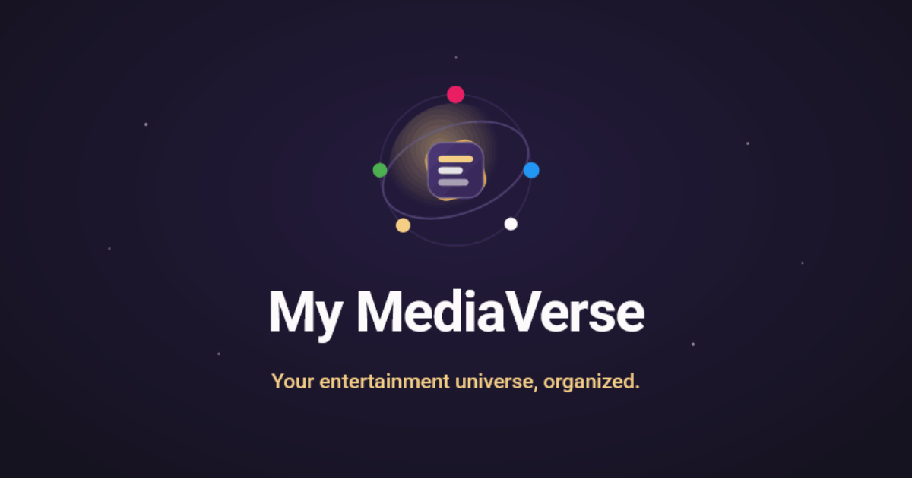

# My MediaVerse
## Version 1.5

*Last updated: 11/7/2026*

**One home for everything you read, watch, and listen to — track it, organize it, and rediscover it.**

<p align="center">
  
</p>

> **Version 1.5** — "The Great Refactor" is complete: the backend and frontend have been re-architected, both test suites rebuilt from scratch, and several new integrations added on top of the v1 demo. **Version 2** (new media types, web archival, automation) is now in active development.

> _Formerly developed under the placeholder name "Project Loopbreaker" — you may still see "PLB" in older commit history, but **My MediaVerse** is the real name._

---

## Table of Contents

- [Overview](#overview)
- [Features](#features)
- [Tech Stack](#tech-stack)
- [Architecture](#architecture)
- [Getting Started](#getting-started)
- [API Endpoints](#api-endpoints)
- [Demo Site](#demo-site)
- [Testing](#testing)
- [Roadmap (v2)](#roadmap-v2)
- [Project Status](#project-status)
- [Contributing](#contributing)
- [License](#license)
- [Acknowledgments](#acknowledgments)

---

## Overview

My MediaVerse (MMV) is a comprehensive personal media library management application designed to help you **track, organize, and discover** content across every format you consume. Books you've read, podcasts you're working through, movies on your watchlist, articles you've saved, notes from your Obsidian vault — MMV brings them all together in one unified platform instead of scattering them across a dozen single-purpose apps.

I built My MediaVerse after years of trying to organize my entertainment options and never finding a tool that did exactly what I wanted. Plenty of platforms handle one kind of media — movies, say — but none could bring _all_ of my options together. The original placeholder name, "Project Loopbreaker," came from a real problem: it's easy to fall into a loop of pointless phone-scrolling when you can't decide what to do. With everything in one place, that's solved. If I'm bored, I just pull up one of my Mixlists for whatever topic I'm in the mood for and immediately find something to read, watch, or listen to.

I'm a fiction writer, and I often compare programming to writing. If the **v1** read-only demo (shared at graduation) was the *first draft*, then **v1.5** is the *editing pass* — a deep refactor incorporating everything I learned during my apprenticeship and coursework, building a solid foundation before the major feature expansion of v2.

### Who is it for?

- **Avid media consumers** who want to track their consumption across many formats at once
- **Note-takers** who want to connect reading highlights and notes back to their source material
- **Curators** who enjoy building themed collections of diverse content
- **Knowledge workers** who want their Obsidian notes living alongside their media library

---

## Features

### Media Library Management

- **8 media types supported:** Books, Podcasts (series & episodes), Movies, TV Shows, YouTube (videos, channels, and playlists), Articles, Websites, and Notes
- **Status tracking:** Uncharted, Actively Exploring, Completed, or Abandoned
- **Rating system:** SuperLike, Like, Neutral, or Dislike
- **Classification:** Organize with genres and topics for easy discovery
- **Ownership tracking:** Track whether you own, rented, or streamed an item
- **Personal notes & links** on any item, with the ability to link to external documentation

### Mixlists — Cross-Type Collections

Create themed playlists called **Mixlists** that can hold *any combination* of media types. Unlike a traditional playlist, a Mixlist isn't limited to one format — it's a flexible collection built around a theme, topic, or any criteria you choose. Want a science-fiction collection? Drop in your favorite novels, podcasts, films, and short stories side by side.

### External Integrations

| Service                  | What it does                                                          |
| ------------------------ | -------------------------------------------------------------------- |
| **Apple Podcasts**       | Podcast directory search; resolves shows to their RSS feeds (no key) |
| **Podcast RSS feeds**    | Each show's own feed is the source of its metadata                   |
| **Podcast Index**        | Fallback podcast directory, including lookup by feed URL              |
| **TMDB**                 | Movie and TV show metadata enrichment                                |
| **Trakt**                | Import your movie and TV watch history, watchlist, and ratings       |
| **YouTube Data API**     | Import videos, channels, and playlists                               |
| **Readwise / Reader**    | Sync highlights and saved articles, auto-linked to their sources     |
| **Google Books**         | Book search and metadata retrieval                                   |
| **Open Library**         | Book metadata and description enrichment                             |
| **Obsidian (Quartz)**    | Sync notes from your personal Obsidian vaults                        |

### Sync Workflows

Dedicated sync pages make bulk imports painless:

- **Trakt sync** — pull in your entire movie and TV watch history, watchlist, and ratings via device authorization
- **Readwise sync** — import highlights and articles in one pass, with highlights automatically linked back to their source books and articles
- **YouTube account connection** — connect your YouTube account to import your own playlists, including private ones
- **Goodreads import** — upload your Goodreads library export; large files are sent in chunks so nothing times out
- **Podcast OPML import** — bring your subscriptions over from another podcast app in one file

### Search & Discovery

- **Typesense-powered search:** fast, typo-tolerant full-text search across your entire library
- **Advanced filtering:** filter by media type, topic, genre, or status, and combine filters
- **Batch indexing model:** indexing runs in bulk — manually from the admin dashboard or on a schedule — rather than on every individual save, so large imports stay fast

### Highlights & Notes

- Import highlights from Readwise, automatically linked to their source articles and books
- Bulk-linking tools to associate orphaned highlights with sources
- Sync notes from your Obsidian vaults and link them to related media items

### Metadata Enrichment

Imported items don't stay bare. Enrichment services fill in and refresh details from each source, run from the admin area or as optional background jobs:

- **Books** — missing descriptions from Google Books and Goodreads ratings converted to MMV ratings
- **Movies & TV** — details from TMDB, with stale records refreshed
- **Podcasts** — series details filled from each show's own RSS feed
- **Websites** — page metadata, thumbnails, and broken-link checks
- **YouTube** — video data refreshed every 30 days, in line with YouTube's terms

### AI-Powered Discovery

My MediaVerse uses AI to enhance organization and discovery:

| Feature                       | Description                                                                                                        |
| ----------------------------- | ----------------------------------------------------------------------------------------------------------------- |
| **Vector embeddings**         | Semantic embeddings for all media items and notes, generated inside Typesense (auto-embedding) using OpenAI's `text-embedding-3-large` |
| **Similar items**             | Surface semantically related media and notes based on embedding similarity                                        |
| **AI note summaries**         | Concise descriptions auto-generated for notes using DigitalOcean Gradient serverless inference (`openai-gpt-oss-120b`) |

> Two AI providers are used intentionally — OpenAI for embeddings, DigitalOcean Gradient for text generation — because each serves a distinct purpose and the single-user cost difference is negligible.

### Admin Dashboard

An admin area for operating the library:

- **Search reindexing** — trigger bulk Typesense reindexing per collection
- **Background-job monitoring** — observe the scheduled enrichment services
- **AI admin** — monitor AI availability and run note-summary generation
- **Demo read-only mode** — a guarded mode that blocks writes for the public demo

---

## Tech Stack

### Frontend

| Technology              | Purpose                          |
| ----------------------- | -------------------------------- |
| React 18                | UI framework                     |
| Vite                    | Build tool and dev server        |
| Material-UI (MUI)       | Component library                |
| React Router v7         | Client-side routing              |
| TanStack Query v5       | Server-state & data caching      |
| React Hook Form + Zod   | Form handling and validation     |
| react-error-boundary    | Resilient error isolation        |
| Axios                   | HTTP client                      |
| Vitest + RTL + MSW      | Testing                          |

### Backend

| Technology               | Purpose                |
| ------------------------ | ---------------------- |
| ASP.NET Core 10.0        | Web API framework      |
| Entity Framework Core 10 | ORM                    |
| PostgreSQL               | Database               |
| JWT                      | Authentication         |
| Clean Architecture       | Architectural pattern  |

### Infrastructure & DevOps

| Service                     | Purpose                                |
| --------------------------- | -------------------------------------- |
| Typesense (self-hosted)     | Full-text search engine                |
| DigitalOcean Droplet        | Hosts Typesense, the demo database, N8N, and Umami via Docker Compose |
| DigitalOcean Spaces         | File / thumbnail storage               |
| Umami (self-hosted)         | Privacy-friendly analytics             |
| Render.com                  | Application hosting                    |
| Cloudflare                  | DNS, SSL, DDoS protection              |
| Sentry                      | Error monitoring for the API and frontend |
| ASP.NET Core rate limiting  | Per-visitor limits on third-party API proxies, AI-backed searches, and the demo unlock |
| Demo write gate             | Keeps the demo read-only; writes unlock for a short window with an authenticator code |

### AI Services

| Provider                 | Purpose                                    |
| ------------------------ | ------------------------------------------ |
| OpenAI                   | Vector embeddings (`text-embedding-3-large`) |
| DigitalOcean Gradient AI | Text generation for note descriptions      |

---


## Architecture

My MediaVerse follows **Clean Architecture** principles with a layered structure that promotes separation of concerns and testability.

```
  ┌───────── Web.API · Infrastructure ─────────┐   outer ring — frameworks & drivers
  │   ┌─────────── Application ────────────┐   │   use cases / business logic
  │   │   ┌─────────── DTOs ───────────┐   │   │   request & response shapes
  │   │   │   ┌────── Domain ──────┐   │   │   │   entities & domain models
  │   │   │   │       Shared       │   │   │   │   shared kernel (core)
  │   │   │   └────────────────────┘   │   │   │
  │   │   └────────────────────────────┘   │   │
  │   └────────────────────────────────────┘   │
  └──────── dependencies point inward ─────────┘

  Web.API        Controllers, middleware, auth, startup extensions (DI, rate limiting)
  Infrastructure EF Core + migrations, API clients, Typesense, storage, sync & enrichment jobs
  Application    Services, business logic, and the interfaces they expose
  DTOs           API request/response objects (depend on Domain)
  Domain         Entities, enums, domain constants
  Shared         Interfaces, config options, external-API DTOs — the leaf every layer builds on
```

### What "The Great Refactor" changed (v1.5)

The v1.5 refactor was as much about engineering discipline as features:

- **Split the "fat" MediaController** into focused, media-type-specific controllers (book, movie, tvshow, podcast, youtube, article, website, note, …)
- **Slimmed a "god" `Program.cs`** by extracting service registration into composable extension methods and simplifying connection-string resolution
- **Rebuilt the frontend** around a feature-based folder structure with ~25 custom **TanStack Query** hooks for all data access, replacing ad-hoc fetching
- **Moved Typesense to a bulk/scheduled indexing model**, removing per-item realtime indexing that would have wasted processing during large imports
- **Replaced the pgvector pipeline with Typesense auto-embedding.** Before, a background job called OpenAI for each item, stored the vectors in pgvector columns in PostgreSQL (managed with raw SQL outside the EF model), and similarity queries ran as raw SQL. Now Typesense generates and stores the embeddings as documents are indexed, so keyword and semantic search share one index, and the pgvector columns and extension were dropped (see [Search & Embeddings](#search--embeddings))
- **Simplified authorization into one default-deny model.** Before, access control was opt-in per controller (only 11 of 33 controllers used `[Authorize]` anywhere), demo protection was an MVC filter with an admin-key header bypass, and a developer controller exposed 25 seed and cleanup endpoints. Now one fallback policy governs every endpoint, a single middleware enforces the demo's read-only mode, demo writes unlock with an authenticator code, the developer controller is gone, and a test pins every endpoint's access level (see [Access Control](#access-control))
- **Standardized CRUD operations and response shapes across media types:** each media type has its own controller with create, read, update, and delete endpoints that return a typed response DTO; all JSON is camelCase with null fields omitted; unhandled errors share one error body; and syncs and bulk imports are being converged on a standard result shape (success flag, counts, warnings and errors, and timings)
- **Rebuilt both test suites** on open-source tooling (see [Testing](#testing))

### Key Architectural Patterns

- **Clean Architecture:** dependencies flow inward; outer layers (Web.API, Infrastructure) depend on inner ones, with a Shared kernel at the core
- **SOLID principles:** single responsibility, dependency injection throughout
- **Service layer:** business logic separated from controllers
- **Shared interfaces:** cross-layer contracts live in the Shared layer to preserve dependency inversion

### Search & Embeddings

Typesense handles both keyword and semantic search:

- **Four collections** — media items, mixlists, Obsidian notes, and highlights — each searched through its own endpoint
- **Embeddings generated inside Typesense:** every document carries an `embedding_source` field, a short text built from the item (for media items: title, media type, description, topics, and genres). When a document is written, Typesense sends that text to OpenAI (`text-embedding-3-large`) and stores the resulting vector itself. Topics and genres are sorted, so an unchanged item produces identical text and Typesense can skip re-embedding it
- **Hybrid search:** every query combines keyword matching with vector similarity, with a distance cutoff (0.65 by default) so a nonsense query doesn't return the whole library
- **Similar items** run as vector queries against the same embeddings
- **Keyword-only fallback:** without an OpenAI key, collections are created without the embedding field and search stays keyword-only
- **Bulk indexing:** documents are upserted in batches, and a reindex also removes documents whose database rows were deleted

### Access Control

The host decides what exists and whether writes are possible; the caller's identity decides everything else. The frontend's route guards are for user experience only — the API enforces access.

- **One codebase, four hosts:** Production (private, login required), Demo (public, read-only by default), Development, and Testing, selected by `ASPNETCORE_ENVIRONMENT`
- **Default-deny:** one fallback authorization policy covers every endpoint. On production, everything requires a signed-in user, reads included; on the demo, anonymous GET requests are allowed and everything else requires authentication
- **A short anonymous allowlist:** only login, token refresh, the demo unlock/lock/status endpoints, the health check, and the YouTube account-connection callback are open without credentials
- **Operator-only endpoints:** exports, reindexing, AI, enrichment, uploads, and similar admin actions require sign-in even on the demo
- **Environment-gated routes:** password login and the Trakt and Readwise sync endpoints are removed from the demo's route table at startup, so they don't exist there at all
- **Sign-in:** a short-lived access token kept in memory (never in localStorage), plus an HttpOnly refresh cookie that restores the session after a reload
- **Demo unlock:** the demo has no password login. A 6-digit authenticator (TOTP) code opens a 20-minute write window and issues a 20-minute token with no refresh; the unlock endpoint is rate-limited against guessing
- **Demo write gate:** middleware that runs before authentication blocks demo writes outside that window with a clear `403` (`demo_read_only`), which the frontend turns into a friendly message
- **Guarded by tests:** an integration test pins the access level of every endpoint, so a new or changed endpoint fails the build until it's deliberately classified

---

## Getting Started

### Prerequisites

- Node.js 18+
- .NET 10 SDK
- PostgreSQL 16+ (production and the demo run PostgreSQL 18)
- Typesense server

### Frontend Setup

```bash
cd frontend
npm install
npm start          # or: npm run dev
```

The frontend starts at `http://localhost:5173`.

### Backend Setup

```bash
cd src/MyMediaVerse/MyMediaVerse.Web.API
dotnet build
dotnet run
```

The API starts at `http://localhost:5033`.

### Environment Variables

#### Required

| Variable                                                 | Description                         |
| -------------------------------------------------------- | ----------------------------------- |
| `DATABASE_URL` or `ConnectionStrings__DefaultConnection` | PostgreSQL connection string        |
| `JWT_SECRET`                                             | JWT signing key (min 32 characters) |
| `AUTH_USERNAME`                                          | Login username                      |
| `AUTH_PASSWORD`                                          | Login password                      |
| `FRONTEND_URL`                                           | Frontend URL for CORS               |

#### Optional (API Integrations)

| Variable                        | Description              |
| ------------------------------- | ------------------------ |
| `TMDB_API_KEY`                  | TMDB movie/TV API        |
| `YOUTUBE_API_KEY`               | YouTube Data API         |
| `READWISE_API_KEY`              | Readwise / Reader API (`READWISE_API_TOKEN` also works) |
| `TRAKT_CLIENT_ID`               | Trakt sync               |
| `TRAKT_CLIENT_SECRET`           | Trakt sync               |
| `GOOGLE_BOOKS_API_KEY`          | Google Books search (required in practice — the keyless quota is zero) |
| `YOUTUBE_OAUTH_CLIENT_ID`       | YouTube account connection |
| `YOUTUBE_OAUTH_CLIENT_SECRET`   | YouTube account connection |
| `YOUTUBE_OAUTH_REDIRECT_URI`    | YouTube account connection callback URL |
| `TYPESENSE_ADMIN_API_KEY`       | Typesense search         |
| `TYPESENSE_HOST`                | Typesense server URL     |
| `PODCASTINDEX_API_KEY`          | Podcast Index directory  |
| `PODCASTINDEX_API_SECRET`       | Podcast Index directory  |
| `DIGITALOCEANSPACES__ACCESSKEY` | DO Spaces access         |
| `DIGITALOCEANSPACES__SECRETKEY` | DO Spaces secret         |
| `OPENAI_API_KEY`                | OpenAI embeddings        |
| `GRADIENT_API_KEY`              | DigitalOcean Gradient AI |
| `OBSIDIAN_GENERAL_VAULT_URL`, `OBSIDIAN_GENERAL_VAULT_AUTH_TOKEN` | Obsidian (Quartz) note sync — general vault |
| `OBSIDIAN_SYNC_ENABLED`, `OBSIDIAN_SYNC_INTERVAL_HOURS` | Scheduled Obsidian note sync |
| `PAPERLESS_API_URL`, `PAPERLESS_API_TOKEN` | Paperless-ngx document sync |
| `SENTRY_DSN`                    | Sentry error monitoring (API) |
| `N8N_API_KEY`                   | Lets N8N workflows call the API with an API key |
| `DEMO_TOTP_SECRET`              | Authenticator secret for unlocking demo writes |
| `ADDITIONAL_CORS_ORIGINS`       | Extra allowed CORS origins |
| `REQUIRE_HTTPS`                 | Override whether the auth cookie is HTTPS-only |

#### Optional (tuning)

| Variable                              | Description                                  |
| ------------------------------------- | -------------------------------------------- |
| `TYPESENSE_PORT`, `TYPESENSE_PROTOCOL` | Typesense connection details (with a bare `TYPESENSE_HOST`) |
| `TYPESENSE_COLLECTION_PREFIX`         | Prefix for Typesense collection names         |
| `TYPESENSE_EMBEDDING_DIMENSIONS`      | Embedding size for Typesense auto-embedding   |
| `TYPESENSE_HYBRID_DISTANCE_THRESHOLD` | Cutoff for semantic matches in hybrid search  |
| `OPENAI_EMBEDDING_MODEL`              | OpenAI embedding model                        |
| `GRADIENT_GENERATION_MODEL`           | Gradient text-generation model                |

#### Frontend (`frontend/.env`)

| Variable                | Description                                        |
| ----------------------- | -------------------------------------------------- |
| `VITE_API_URL`          | API base URL — must include the `/api` suffix      |
| `VITE_DEMO_MODE`        | `true` for the read-only demo build                |
| `VITE_ENVIRONMENT`      | Environment name reported to Sentry                |
| `VITE_SENTRY_DSN`       | Sentry error monitoring (frontend)                 |
| `VITE_UMAMI_WEBSITE_ID` | Umami analytics site ID                            |

Podcast episode sync is tuned through the optional `PodcastSync` configuration section (the defaults apply when it is absent):

| Setting                 | Default | Meaning                                                                                         |
| ----------------------- | ------- | ----------------------------------------------------------------------------------------------- |
| `FirstSyncEpisodeCount` | 25      | Newest episodes imported the first time a series syncs; older ones stay available to add by hand |
| `MaxEpisodesPerSync`    | 50      | Most new episodes a later sync imports (a warning reports any that were left)                   |
| `RunTimeBudgetSeconds`  | 600     | Wall-clock budget for one sync of all subscribed series (`0` disables it)                       |
| `HostDelayMs`           | 250     | Pause between reads of the same feed host                                                       |
| `FeedCacheMinutes`      | 15      | How long the feed episode browser caches a feed                                                 |

#### Local-only (manual migrations)

These are read from your local shell when running `dotnet ef database update` against each environment.

| Variable                   | Description                                                                        |
| -------------------------- | --------------------------------------------------------------------------------- |
| `PRODUCTION_DB_CONNECTION` | Connection string for the production DB (Render)                                  |
| `DEMO_DB_CONNECTION`       | Connection string for the demo DB via SSH tunnel (`Host=localhost;Port=5433;...`) |
| `DEMO_DROPLET_IP`          | IP of the DigitalOcean Droplet hosting the demo DB                                |

---

## API Endpoints

The API is RESTful with a base URL of `/api`. Controllers are organized by responsibility:

### Media

| Controller | Endpoint         | Description                          |
| ---------- | ---------------- | ----------------------------------- |
| Media      | `/api/media`     | Shared read, update, delete, and export across all media types (each type is created through its own controller) |
| Book       | `/api/book`      | Book-specific operations            |
| Movie      | `/api/movie`     | Movie operations (TMDB)             |
| TVShow     | `/api/tvshow`    | TV show operations                  |
| Podcast    | `/api/podcast`   | Podcast series & episodes, feed import, episode sync, directory search |
| YouTube    | `/api/youtube`   | YouTube lookups, imports, account connection, and data refresh |
| Video      | `/api/video`     | Stored online videos                |
| YouTubeChannel | `/api/youtubechannel` | Stored channels and latest-upload imports |
| YouTubePlaylist | `/api/youtubeplaylist` | Stored playlists, mirrored from YouTube on sync |
| Article    | `/api/article`   | Article operations                  |
| Website    | `/api/website`   | Website operations                  |
| Document   | `/api/document`  | Documents and Paperless-ngx sync    |
| Note       | `/api/note`      | Notes management                    |

### Collections, Classification & Discovery

| Controller     | Endpoint              | Description                              |
| -------------- | --------------------- | ---------------------------------------- |
| Mixlist        | `/api/mixlist`        | Cross-type collection management         |
| Topics         | `/api/topics`         | Topic management                         |
| Genres         | `/api/genres`         | Genre management                         |
| Highlight      | `/api/highlight`      | Highlight operations and linking         |
| Search         | `/api/search`         | Typesense search + bulk reindexing       |
| Recommendation | `/api/recommendation` | Similar-items / embedding-based discovery |
| RelatedMedia   | `/api/relatedmedia`   | Media relationships                      |

### Integrations & Sync

| Controller  | Endpoint          | Description                          |
| ----------- | ----------------- | ------------------------------------ |
| Readwise    | `/api/readwise`   | Readwise + Reader sync               |
| Trakt       | `/api/trakt`      | Trakt TV watch-history sync          |
| TMDB        | `/api/tmdb`       | Movie / TV search proxy              |
| Upload      | `/api/upload`     | Thumbnail uploads, CSV and Goodreads imports |
| BookEnrichment | `/api/bookenrichment` | Book descriptions, authors, and ratings |
| MovieTvEnrichment | `/api/movietvenrichment` | TMDB enrichment and stale refresh |
| PodcastEnrichment | `/api/podcastenrichment` | Podcast series enrichment from feeds |
| WebsiteEnrichment | `/api/website/enrichment` | Website metadata, thumbnails, and link checks |

### AI, Admin & Ops

| Controller | Endpoint        | Description                         |
| ---------- | --------------- | ----------------------------------- |
| AI         | `/api/ai`       | Note summary generation & AI status |
| Auth       | `/api/auth`     | Authentication                      |
| Demo       | `/api/demo`     | Demo write-access unlock and status |
| Health     | `/api/health`   | Service health checks               |

---

## Demo Site

**Live Demo:** [https://demo.mymediaverseuniverse.com](https://demo.mymediaverseuniverse.com)

The demo site runs in **read-only mode** by default, so you can explore the interface and features without modifying data. Sample data is included to demonstrate all media types and functionality.

A public **Terms & Privacy** page (`/privacy`) explains how the app uses YouTube and other third-party data.

---

## Testing

Both test suites were rebuilt from scratch during v1.5 on actively maintained, open-source tooling.

- **Backend:** xUnit, **NSubstitute** (mocking), **AwesomeAssertions**, and **Testcontainers** for real PostgreSQL integration tests
- **Frontend:** **Vitest**, React Testing Library, and **MSW** (Mock Service Worker) with shared data factories and a `renderWithProviders` helper

### Run All Tests

```powershell
.\scripts\run-all-tests.ps1   # run from anywhere; logs go to logs/ at the repo root
```

### Backend Tests

```bash
dotnet test tests/MyMediaVerse.UnitTests/MyMediaVerse.UnitTests.csproj
dotnet test tests/MyMediaVerse.IntegrationTests/MyMediaVerse.IntegrationTests.csproj
```

### Frontend Tests

```bash
cd frontend
npm test              # Watch mode
npm run test:run      # Single run
npm run test:coverage # With coverage
```

The coverage run prints a per-file table and writes an HTML report to `frontend/coverage/index.html`. Every source file under `src/` is counted, including files that have no tests yet (see the `coverage` block in `frontend/vitest.config.js`).

### Backend Coverage

```powershell
.\scripts\run-backend-coverage.ps1                      # Unit tests only
.\scripts\run-backend-coverage.ps1 -IncludeIntegration  # Unit + integration (needs Docker)
```

On Linux, use `./scripts/run-backend-coverage.sh` (add `--integration` for both suites). The HTML report is written to `coverage/backend/index.html`. EF Core migrations and auto-properties are excluded from the numbers (see `tests/coverlet.runsettings`).

Test results are saved to the `logs/` directory with timestamps.

---

## Roadmap (v2)

Version 2 expands the feature set on top of the v1.5 foundation:

- **New media types:** Video Games, Music, Courses, and *Panorama* — a catch-all type for anything that doesn't fit neatly elsewhere
- **Web bookmarking & archival:** webpage hierarchy, **ArchiveBox** archival, link de-duplication, and scheduled broken-link monitoring
- **Transcription import** for podcasts and videos

### In flight

- **Search Refactor** — queued/batched Typesense indexing, delete propagation, and a cleaner frontend search flow, hardening search for a full-size library
- **Initial Data Sync** — running the first full data population
- **N8N automation** — workflows for enrichment and syncs are in progress
- **Document management** — **Paperless-ngx** sync and a Documents page are built; complete functionality is in progress
- **Wayback Machine** — snapshot lookups as a fallback when enriching websites; testing is in progress

---

## Project Status

**Current Version:** v1.5 — *The Great Refactor* complete.

### Completed in v1.5

- Backend re-architecture (controller split, slimmed `Program.cs`, clean dependency flow)
- Frontend re-architecture (feature folders, TanStack Query data layer, shared components)
- Both test suites rebuilt on open-source tooling
- New integrations: Trakt sync, Obsidian/Quartz note sync, YouTube account connection
- New imports: Goodreads (chunked uploads) and podcast OPML
- Metadata enrichment services for books, movies & TV, podcasts, websites, and YouTube
- Bulk/scheduled Typesense indexing model
- AI embeddings, similar-items discovery, and AI note summaries
- Read-only demo site with sample data
- Demo access control simplified: the demo stays read-only, and writes unlock for a short window with an authenticator code
- Rate limiting on third-party API proxies, AI-backed searches, and the demo unlock
- Error monitoring with Sentry across the API and frontend

### Next

Populate the library via the **Initial Data Sync**, complete the **Search Refactor**, then begin **v2** feature expansion.

---

## License

**Proprietary License**

Please do not copy or redistribute this code without permission.

This project is source-available for portfolio and reference purposes — it is not open source. Viewing the code is welcome, but reuse or redistribution requires explicit written permission.

See [LICENSE](./LICENSE.txt) for full terms.

---

## Acknowledgments

This project integrates with and is grateful for the following services and APIs:

- [Apple iTunes Search API](https://performance-partners.apple.com/search-api) — Podcast directory search and lookup
- [Podcast Index](https://podcastindex.org/) — Open podcast directory, used as a fallback and for feed-URL lookups
- [TMDB](https://www.themoviedb.org/) — Movie and TV database
- [Trakt](https://trakt.tv/) — TV watch-history and tracking API
- [YouTube Data API](https://developers.google.com/youtube/v3) — Video platform integration
- [Readwise](https://readwise.io/) — Reading highlights service
- [Google Books API](https://developers.google.com/books) — Book metadata
- [Open Library](https://openlibrary.org/) — Open book metadata
- [Typesense](https://typesense.org/) — Open-source search engine
- [OpenAI](https://openai.com/) — Embedding models for semantic discovery
- [DigitalOcean Gradient AI](https://www.digitalocean.com/products/gradient) — Text generation
- [TanStack Query](https://tanstack.com/query) — Frontend data management
- [MSW](https://mswjs.io/) — API mocking for tests
- [Material-UI](https://mui.com/) — React component library

---

*Built with care for personal media management.*

— Portfolio: [raeccleston.com](https://www.raeccleston.com/) · Repo: [github.com/rnacodes/my-mediaverse](https://github.com/rnacodes/my-mediaverse)
